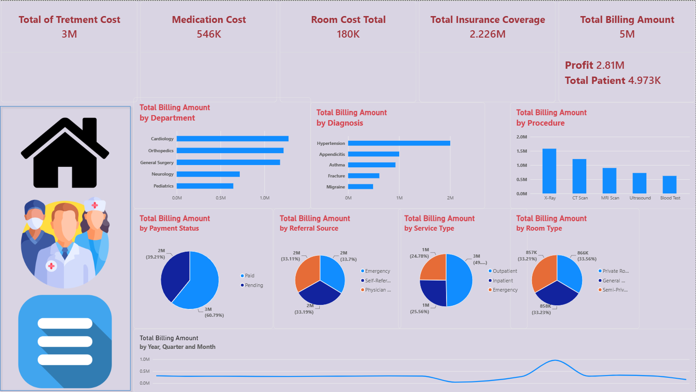

# Healthcare Billing & Cost Analysis Dashboard

**Power BI · DAX · Power Query · Healthcare Analytics**

A three-page Power BI report exploring billed amounts, recorded costs, payment status, and provider activity. This portfolio case shows how to connect an operational dashboard to financial questions while checking metric definitions and the consistency of its narrative.

## Business questions

- Which departments, diagnoses, and procedures contribute the most billing?
- How do insurance coverage and payment status relate to billed amounts?
- How does provider activity vary by recorded patient counts and billing?

## What the saved report displays

| Metric | Displayed value |
| --- | ---: |
| Total billing | 5M |
| Treatment cost | 3M |
| Medication cost | 546K |
| Room cost | 180K |
| Insurance coverage | 2.226M |
| Report's “Profit” card | 2.81M |
| Report's “Total Patient” card | 4.973K |

These are rounded screenshot values. Currency, source period, row grain, and the exact DAX expressions are not documented in the supplied files. The patient card is not treated as a verified distinct-person count.

**Financial reconciliation needs review:** 5M billing minus 3M treatment cost does not reconcile to the displayed 2.81M profit. The cost components' overlap and the profit measure must be checked in Power BI Desktop before describing this as net profit or quoting a verified profit margin.

## Findings and recommended follow-up

| Observation | Business question to investigate |
| --- | --- |
| Cardiology leads department billing, followed by Orthopedics and General Surgery | Is the mix driven by patient volume, procedure mix, or billing per encounter? |
| X-Ray and CT Scan lead the procedure billing chart | Do their billing contributions align with procedure costs and capacity? |
| Medication cost exceeds room cost in the displayed cards | How are these costs allocated, and do they overlap with treatment cost? |
| Provider billing and patient-count charts vary substantially | How much of the variation reflects workload and case mix? |

Provider comparisons describe recorded activity; they do not establish clinical quality or individual efficiency.

## Payment-status discrepancy

The Main page legend shows **Paid in light blue (60.79%)** and **Pending in dark blue (39.21%)**. The existing More Details page says the opposite. This README follows the visible Main chart legend and flags the disagreement rather than repeating the conflicting narrative as a confirmed finding.

The underlying status aggregation still needs verification in Power BI Desktop. Neither billed revenue nor a pending-status share proves cash collection, overdue debt, or the timing of payment. An aging report would require due dates and payment history.

## Report pages

| Page | Purpose | Preview |
| --- | --- | --- |
| Main | Billing, cost cards, department/diagnosis/procedure breakdowns, payment status | [Main page](screenshots/main-page.png) |
| Provider | Billing, recorded patient counts, and the report's profit measure by provider | [Provider page](screenshots/provider-page.png) |
| More Details | Original narrative summary; contains the discrepancies described above | [Original insights page](screenshots/more-details-page.png) |

## Open and review

1. Download or clone the repository.
2. Open [Hospital Project.pbix](Hospital%20Project.pbix) in a current Windows installation of Power BI Desktop.
3. Inspect the profit measure, payment-status categories, and patient-count aggregation before relying on those KPIs.
4. Review Power Query connections before refreshing. Separate source tables and connection instructions are not included.

For a browser review, use the screenshots. No hosted interactive Power BI link is included.

## Portfolio evidence

The report demonstrates multi-page dashboard organization, financial KPI presentation, department and procedure comparisons, and provider activity exploration. [The case study](docs/case-study.md) explains the reasoning and [review notes](docs/report-review.md) distinguish observed values from calculations that need validation.

File validation confirms an intact PBIX archive, an embedded model, three populated report pages, and valid screenshot CRCs. It does not verify DAX evaluation, source refresh, or report interaction. The original PBIX and screenshots remain unchanged, including their documented narrative inconsistencies.

## Related projects

[Retail SQL & Profitability Analysis](https://github.com/marwanfaisal14/retail-sales-analysis) · [Pizza Sales Dashboard](https://github.com/marwanfaisal14/Pizza-sales-dashboard)
